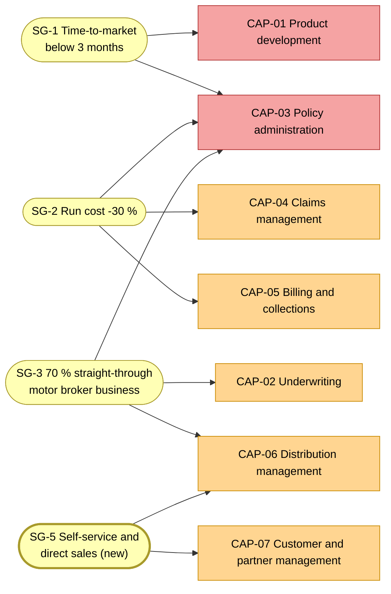
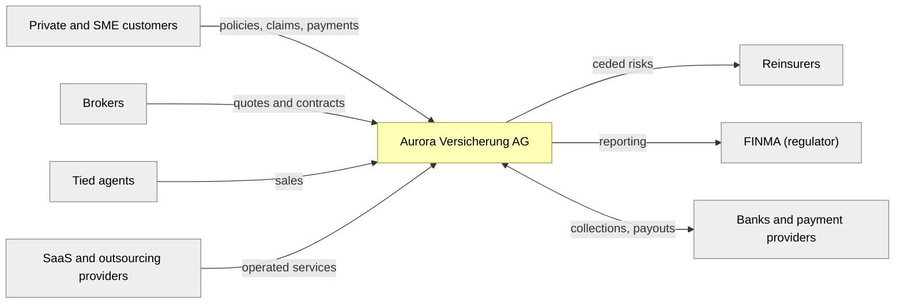
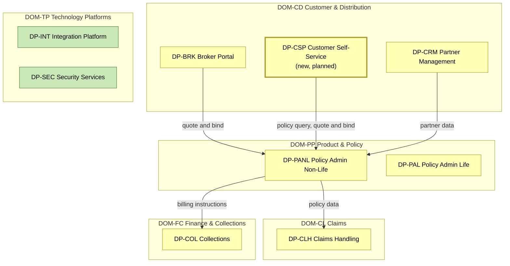
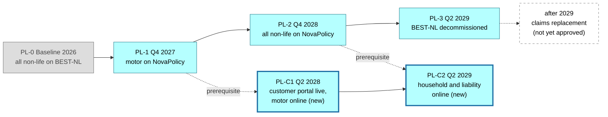

# Enterprise Blueprint – Aurora Versicherung AG

## 1 Introduction and goals
### 1.1 Strategic goals and drivers
Aurora is a mid-sized Swiss multi-line insurer. The 2026–2030 strategy is driven by margin
pressure in non-life, brokers expecting digital quote-and-bind, and FINMA requirements on
operational resilience.

| ID | Goal |
|---|---|
| SG-1 | Time-to-market for new non-life products below 3 months (today 9 months) |
| SG-2 | Reduce run cost of non-life policy administration by 30 % by 2030 |
| SG-3 | Straight-through quote-and-bind for at least 70 % of motor broker business |
| SG-4 | Operational resilience in line with FINMA Circular 2023/1 |
| SG-5 | Digital self-service and direct sales for private customers: 40 % of service requests self-service by 2029, motor bought online by customers without a broker (new, ADR-ENT-004) |

### 1.2 Capability map and heatmap
<!-- adoit-view: ENT-CAPMAP-HEAT -->

Red: CAP-01 Product development and CAP-03 Policy administration. Both are constrained by the
in-house system BEST-NL (product changes require code releases, high run cost).
Amber: CAP-02, CAP-04, CAP-05, CAP-06, and CAP-07 since SG-5 was added (customer self-service).

### 1.3 Stakeholders
| Stakeholder | Concern | Relevant chapters |
|---|---|---|
| Board of directors, executive board | strategy fit, risk, investment | 1, 4, 13 |
| CRO, compliance | regulation, outsourcing, resilience | 2, 10, 11 |
| CISO | security, data protection | 2, 4.2, 10 |
| Domain architects | principles, cross-domain decisions | 4, 8, 9 |

## 2 Constraints (inherited)
| ID | Constraint | Source |
|---|---|---|
| REG-01 | FINMA Circular 2023/1 operational risks and resilience | regulator |
| REG-02 | FINMA requirements on outsourcing | regulator |
| REG-03 | Swiss Federal Act on Data Protection (revFADP) | law |

## 3 Context
<!-- adoit-view: ENT-CONTEXT -->

External parties: private and SME customers, brokers, tied agents, reinsurers, FINMA,
banks and payment providers, SaaS and outsourcing providers.

## 4 Solution strategy and enterprise principles
### 4.1 Architecture strategy
- Standard software for non-differentiating capabilities, Aurora's own development for
  differentiating digital journeys (broker and customer front ends).
- Replacement of legacy core systems line of business by line of business, never big bang.
- The Enterprise Integration Platform decouples domains, so core systems can be replaced
  without forcing neighbouring domains to change at the same time.
- A direct digital channel for private customers complements brokers and agents; brokered
  business stays with the broker (ADR-ENT-004). Customer identities are a central platform
  service (ADR-ENT-005).

### 4.2 Enterprise principles
| ID | Principle | Rationale | Implications |
|---|---|---|---|
| EP-01 | Buy before make for non-differentiating capabilities | focus scarce engineering on differentiation | make requires an ADR |
| EP-02 | Integration via EIP, no point-to-point | replaceability, observability | adapters and contracts on EIP |
| EP-03 | Exactly one system of record per business object | data consistency, clear ownership | migrations need explicit handling |
| EP-04 v2 | Product definitions in one platform per LoB group; integrated product engines of standard packages are allowed if product data is exposed via canonical APIs | changed by waiver ADR-ENT-003 | see ADR-ENT-003 |
| EP-05 | Personal data protected by design and minimised | revFADP | data classification mandatory |
| EP-06 | Events in canonical, versioned formats | decoupling of consumers | schema registry on EIP |

### 4.3 Standards
Generated from ADOIT: STD-API-01, STD-EVT-01, STD-IAM-01, STD-LOG-01, STD-DAT-01, STD-OUT-01.
Relevance per system is derived from system attributes (see `00-adoit-model-extract.md`).

## 5 Building blocks: domains
<!-- adoit-view: ENT-DOMAIN-MAP -->

| Domain | ADOIT ID | Domain Blueprint | Domain architect |
|---|---|---|---|
| Customer & Distribution | DOM-CD | domain-blueprint-cd.md | U. Roth |
| Product & Policy | DOM-PP | 02-domain-blueprint-product-policy.md | N. Fischer |
| Claims | DOM-CL | domain-blueprint-cl.md | H. Lang |
| Finance & Collections | DOM-FC | domain-blueprint-fc.md | H. Lang |
| Technology Platforms | DOM-TP | domain-blueprint-tp.md | U. Roth |

## 8 Cross-domain patterns
| Pattern | Problem | Solution | Applies when |
|---|---|---|---|
| Legacy-format feed | A domain replaces its core system, consumers in other domains cannot change in time | Adapter in the providing domain keeps delivering the old format from the new system | core replacement with stable consumers |
| Canonical event publication | Consumers coupled to internal models of providers | Providers publish canonical events on EIP | any cross-domain data flow |

## 9 Decisions
| ADR | Title | Type | Status | Date |
|---|---|---|---|---|
| ADR-ENT-001 | Claims and collections stay on legacy and are fed by the policy domain | decision | accepted | 2026-03-12 |
| ADR-ENT-002 | Two systems of record for policies during migration, partitioned by LoB | exception | accepted | 2026-03-12 |
| ADR-ENT-003 | Integrated product engine of NovaPolicy instead of central product platform | waiver | accepted, principle changed | 2026-04-02 |
| ADR-ENT-004 | Direct digital channel for private customers, with broker-of-record protection | decision | accepted | 2026-11-16 |
| ADR-ENT-005 | Customer identity as a central platform service (CIAM) | decision | accepted | 2026-11-16 |

## 10 Quality requirements
| Quality goal | Target |
|---|---|
| Resilience of critical services (policy, claims) | recovery within 4 hours, data loss below 15 minutes |
| Security logging | all production systems within STD-LOG-01 |
| Data residency | all PII in Switzerland |

## 11 Risks, technical debt, exceptions
| ID | Type | Description | Owner | Expiry / target date | Ticket |
|---|---|---|---|---|---|
| EXC-ENT-002 | exception | dual system of record policy (ADR-ENT-002) | DP Manager IT DP-PANL | PL-3, Q2 2029 | TD-PANL-001 |
| EXC-PANL-001 | exception | NovaPolicy audit logs daily instead of 15 min (ADR-SYS-NOVA-002) | DP Manager IT DP-PANL | 2028-06-30 | TD-PANL-004 |
| R-ENT-01 | risk | migration of 3 LoB within 2 years binds key staff in DOM-PP, DOM-CL, DOM-FC | programme lead | – | – |
| R-ENT-02 | risk | brokers perceive the customer portal as competition (ADR-ENT-004) | Head of Distribution | broker information before PL-C1 | – |

Model quality (from ADOIT): 97 % systems with domain, 91 % interfaces complete, 88 % business
objects classified.

## 12 Glossary
| Term | Meaning |
|---|---|
| LoB | Line of business (motor, household, liability, ...) |
| System of record | the system holding the authoritative version of a business object |

## 13 Roadmap and transition
<!-- adoit-view: ENT-ROADMAP -->

| Plateau | Target date | Content | Initiatives |
|---|---|---|---|
| PL-1 | Q4 2027 | Motor on NovaPolicy | Core Replacement Non-Life |
| PL-2 | Q4 2028 | All non-life on NovaPolicy | Core Replacement Non-Life |
| PL-3 | Q2 2029 | BEST-NL decommissioned | Core Replacement Non-Life |
| PL-C1 | Q2 2028 | Customer portal live, motor online for customers without a broker | Customer Self-Service (new, SB-005) |
| PL-C2 | Q2 2029 | Household and liability online | Customer Self-Service (new) |
| – | after 2029 | Claims replacement (not yet approved) | – |
