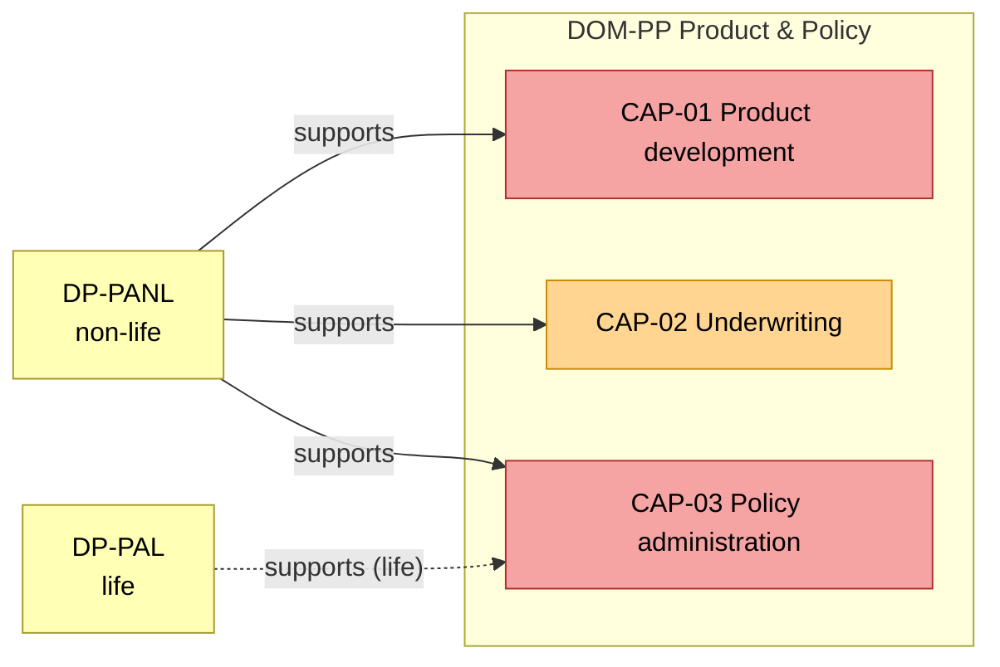
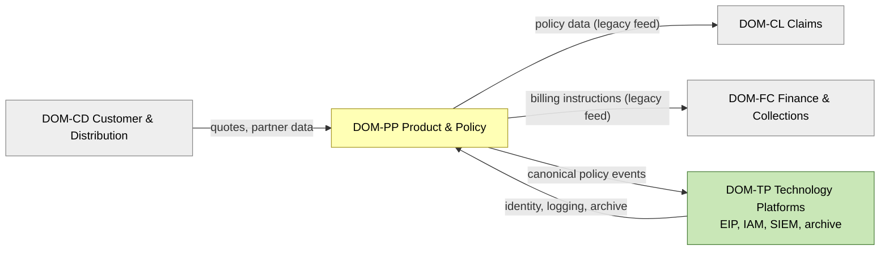
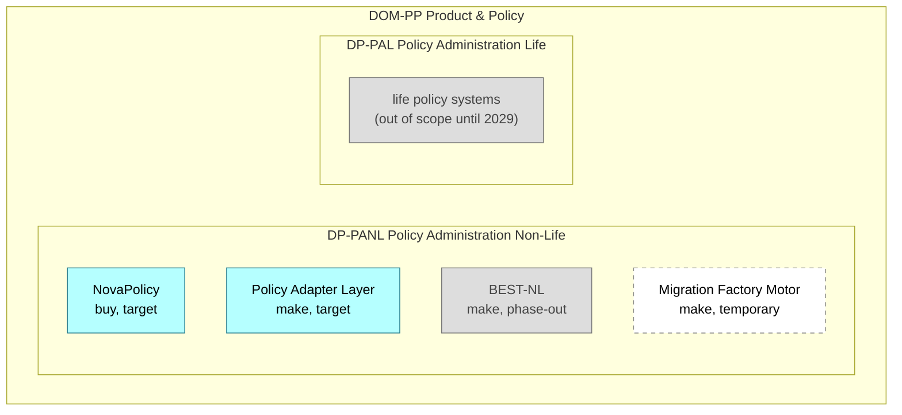
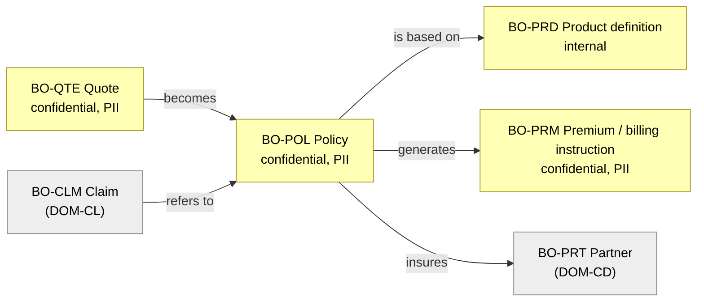
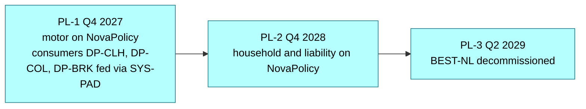

# Domain Blueprint – Product & Policy

## 1 Introduction and goals
### 1.1 Domain goals
Contribute to SG-1 (product time-to-market), SG-2 (run cost) and SG-3 (straight-through
processing) by replacing BEST-NL with a configurable standard package.

### 1.2 Capabilities in scope
<!-- adoit-view: DOM-PP-CAPS -->

CAP-01 Product development, CAP-02 Underwriting, CAP-03 Policy administration.

### 1.3 Stakeholders
Product management non-life and life, underwriting, policy operations, brokers (via DOM-CD),
claims and collections as consumers of policy data.

## 2 Constraints (inherited)
| ADOIT ID | Principle / standard | Interpretation for this domain |
|---|---|---|
| EP-01 | Buy before make | policy administration and product definition are non-differentiating |
| EP-02 | Integration via EIP | all policy data leaves the domain via SYS-PAD and EIP |
| EP-03 | One system of record | temporarily overridden by ADR-ENT-002, partitioned by LoB |
| EP-04 v2 | Product platform per LoB group | NovaPolicy product engine for non-life |
| EP-05 | Privacy by design | policy and quote contain PII |
| EP-06 | Canonical events | canonical policy format, see DPP-01 |
| STD-API-01, STD-EVT-01, STD-DAT-01, STD-LOG-01, STD-OUT-01 | standards | relevance per system in DP and System Blueprints |

## 3 Context
<!-- adoit-view: DOM-PP-CONTEXT -->

Neighbouring domains: DOM-CD (broker portal, partner master), DOM-CL (claims consumes policy
data), DOM-FC (collections consumes billing instructions), DOM-TP (EIP, IAM, SIEM, archive).

## 4 Solution strategy and domain principles
### 4.1 Domain architecture strategy
- Non-life policy administration moves to NovaPolicy, LoB by LoB (ADR-DP-002).
- The domain shields its consumers from the replacement: SYS-PAD keeps delivering legacy
  formats where consumers cannot change yet (pattern "Legacy-format feed", ADR-ENT-001).
- Life (DP-PAL) is out of scope until 2029.

### 4.2 Domain principles
| ADOIT ID | Principle | Refines | Statement | Rationale | Implications |
|---|---|---|---|---|---|
| DPP-01 | Canonical policy format | EP-06 | policy events leave the domain only as `policy.nonlife.v1` | consumers independent of policy system | SYS-PAD maps every source |
| DPP-02 | Shielded consumers | EP-02 | changes of policy systems must not force changes in other domains before they plan them | decouples roadmaps | legacy formats delivered as long as needed |

## 5 Building blocks: digital products
<!-- adoit-view: DOM-PP-DP-MAP -->

| DP | ADOIT ID | DP Blueprint | DP Manager Business | DP Manager IT | Solution architect |
|---|---|---|---|---|---|
| Policy Administration Non-Life | DP-PANL | 03-dp-blueprint-policy-admin-nonlife.md | A. Meier | T. Brunner | L. Weber |
| Policy Administration Life | DP-PAL | dp-blueprint-pal.md | C. Huber | T. Brunner | L. Weber |

### 5.1 Business objects
<!-- adoit-view: DOM-PP-BO -->

BO-POL Policy (confidential, PII), BO-PRD Product definition (internal), BO-QTE Quote
(confidential, PII), BO-PRM Premium / billing instruction (confidential, PII).

## 8 Domain patterns
| Pattern | Problem | Solution | Applies when | Origin |
|---|---|---|---|---|
| LoB migration to NovaPolicy | moving a LoB from BEST-NL to NovaPolicy | product configuration, migration factory, cutover weekend, reconciliation, legacy-format feed | each non-life LoB | SB-001 (candidate, becomes pattern on second reuse with SB-002) |

## 9 Decisions
| ADR | Title | Type | Status | Date |
|---|---|---|---|---|
| ADR-DOM-001 | Canonical policy event format `policy.nonlife.v1` aligned to ACORD | decision | accepted | 2026-05-20 |

## 11 Risks, technical debt, exceptions
| ID | Type | Description | Owner | Expiry / target date | Ticket |
|---|---|---|---|---|---|
| R-PP-01 | risk | canonical format may not cover life products later | N. Fischer | review 2028 | – |

## 12 Glossary
| Term | Meaning |
|---|---|
| Cutover | switch of a LoB from BEST-NL to NovaPolicy |

## 13 Roadmap and transition
<!-- adoit-view: DOM-PP-ROADMAP -->

| Plateau | Target date | Content | Affected DPs |
|---|---|---|---|
| PL-1 | Q4 2027 | motor on NovaPolicy | DP-PANL (consumers: DP-CLH, DP-COL, DP-BRK) |
| PL-2 | Q4 2028 | household and liability on NovaPolicy | DP-PANL |
| PL-3 | Q2 2029 | BEST-NL decommissioned | DP-PANL |
