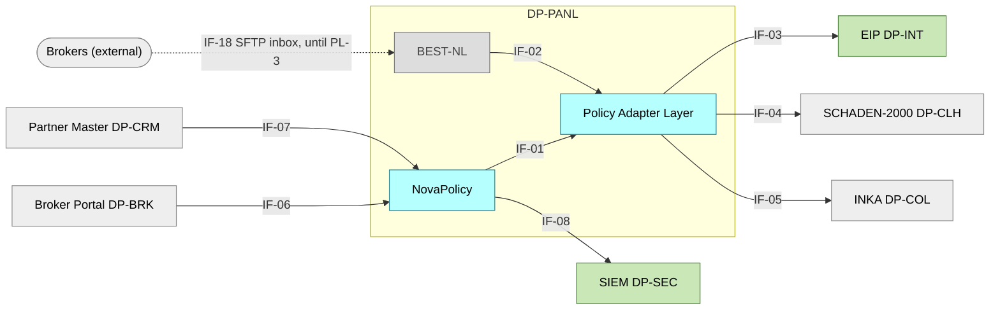
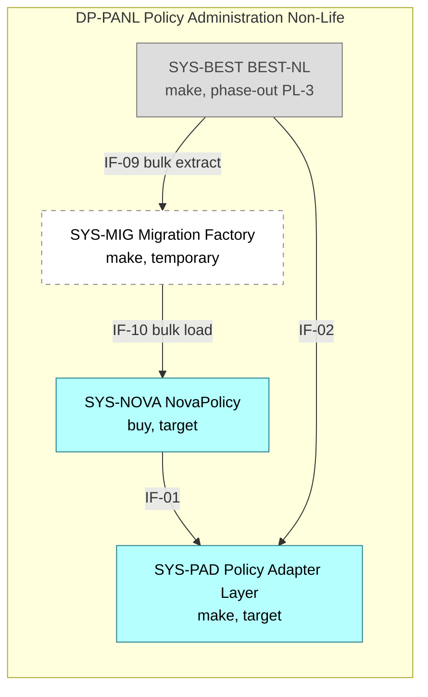
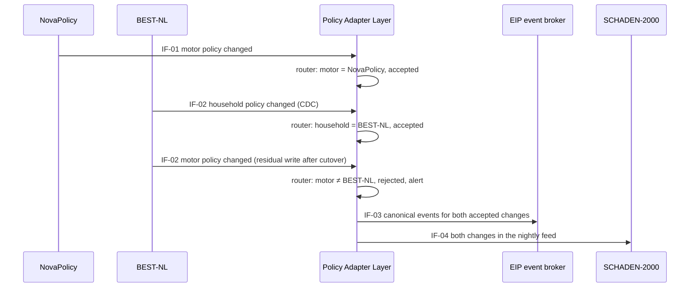
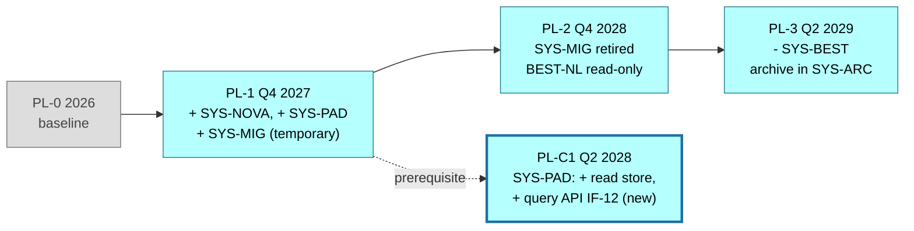

# DP Blueprint – Policy Administration Non-Life

## 1 Introduction and goals
### 1.1 Product goals and business outcomes
| Outcome | Measure | Contributes to |
|---|---|---|
| New non-life products configured, not coded | time-to-market below 3 months | SG-1 |
| Lower run cost | -30 % by 2030 after BEST-NL shutdown | SG-2 |
| Motor quote-and-bind without manual steps | 70 % straight-through | SG-3 |

### 1.2 Capabilities supported
CAP-01 (non-life), CAP-02 (non-life), CAP-03 (non-life).

### 1.3 Stakeholders and ownership
| Role | Name | Accountable for model objects |
|---|---|---|
| DP Manager Business | A. Meier | business objects, data classification, capability relations |
| DP Manager IT | T. Brunner | systems, aliases, interfaces |
| Solution architect (reviewer) | L. Weber | – |

## 2 Constraints (inherited)
| ADOIT ID | Principle / standard | Source level |
|---|---|---|
| EP-01 ... EP-06 | enterprise principles | Enterprise |
| DPP-01, DPP-02 | domain principles | Domain DOM-PP |
| ADR-ENT-001, ADR-ENT-002 | decisions binding this DP | Enterprise |
| ADR-DOM-001 | canonical policy format | Domain |
| STD-SEC-01 | malware scanning at the first point of entry (new, owner CISO) | Enterprise |

## 3 Context
<!-- adoit-view: DP-PANL-CONTEXT -->

Cross-DP interfaces: IF-03 to IF-08. Every change to one of them raises the change class.

## 4 Solution strategy
- NovaPolicy is the target for all non-life LoB (ADR-DP-001).
- Migration LoB by LoB, motor first (ADR-DP-002).
- SYS-PAD is the only exit for policy data, so consumers never see which policy system holds
  a LoB.

## 5 Building blocks: systems
<!-- adoit-view: DP-PANL-SYSTEMS -->

| System | ADOIT ID | Profile | System Blueprint | Lifecycle |
|---|---|---|---|---|
| NovaPolicy | SYS-NOVA | buy | 04-system-blueprint-novapolicy.md | target |
| Policy Adapter Layer | SYS-PAD | make | 05-system-blueprint-policy-adapter-layer.md | target |
| BEST-NL | SYS-BEST | make | none (see FINDINGS F4) | phase-out, PL-3 |
| Migration Factory Motor | SYS-MIG | make | only in SB-001 | temporary |

## 6 Runtime
Routing by line of business at PL-1: the same consumer interfaces are served from two systems of record.

<!-- adoit-view: DP-PANL-RUNTIME-ROUTING -->

## 8 Cross-cutting concepts and patterns
- **Routing by LoB:** SYS-PAD holds a routing table LoB → system of record. Switching a LoB is
  a configuration change at cutover.
- **Reconciliation:** after each cutover, counts and premium sums are reconciled between
  BEST-NL, NovaPolicy, SCHADEN-2000 and INKA.
- **Data migration:** see domain pattern "LoB migration to NovaPolicy".

## 9 Decisions
| ADR | Title | Type | Status | Date |
|---|---|---|---|---|
| ADR-DP-001 | Replace BEST-NL with NovaPolicy | decision | accepted | 2026-02-10 |
| ADR-DP-002 | Migration by line of business, motor first | decision | accepted | 2026-02-10 |
| ADR-SYS-BEST-001 | Broker document inbox of BEST-NL without malware scanning until decommissioning (system level, held here because BEST-NL has no System Blueprint) | exception | accepted | 2026-11-16 |

## 10 Quality requirements
| Scenario | Target |
|---|---|
| Quote-and-bind via broker portal | response below 2 s for 95 % of requests |
| Policy change visible to claims | next morning (nightly feed IF-04), canonical event within 1 minute |
| Cutover window | one weekend per LoB, rollback possible until Sunday 18:00 |

## 11 Risks, technical debt, exceptions
| ID | Type | Description | Owner | Expiry / target date | Ticket |
|---|---|---|---|---|---|
| EXC-ENT-002 | exception | dual system of record during migration | T. Brunner | Q2 2029 | TD-PANL-001 |
| TD-PANL-002 | technical debt | legacy-format feeds IF-04, IF-05 generated from NovaPolicy | T. Brunner | claims / collections modernisation | TD-PANL-002 |
| EXC-PANL-001 | exception | SIEM logging daily (ADR-SYS-NOVA-002) | T. Brunner | 2028-06-30 | TD-PANL-004 |
| EXC-PANL-002 | exception | BEST-NL broker inbox IF-18 without scanning at entry; nightly scan as compensating control (ADR-SYS-BEST-001) | T. Brunner | 2029-06-30 | TD-PANL-005 |
| R-PANL-01 | risk | data quality of BEST-NL motor policies (about 4 % with incomplete vehicle data) | A. Meier | before PL-1 | – |

## 13 Roadmap and transition
<!-- adoit-view: DP-PANL-ROADMAP -->

| Plateau | Target date | Content | Systems added / retired |
|---|---|---|---|
| PL-0 | 2026 | baseline | – |
| PL-1 | Q4 2027 | motor on NovaPolicy | + SYS-NOVA, + SYS-PAD, + SYS-MIG (temporary) |
| PL-2 | Q4 2028 | household and liability | SYS-MIG retired, BEST-NL read-only |
| PL-3 | Q2 2029 | target | − SYS-BEST, archive in SYS-ARC |
| PL-C1 | Q2 2028 | customer portal (programme Customer Self-Service, SB-005) | SYS-PAD gains read store and query API IF-12 |
