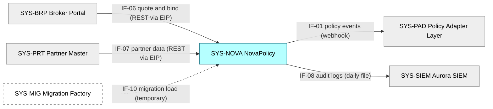
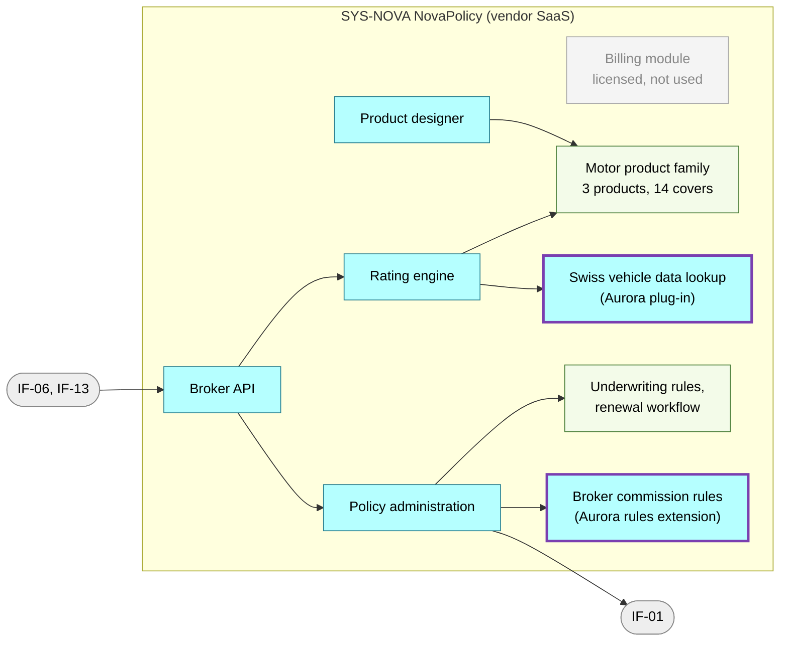
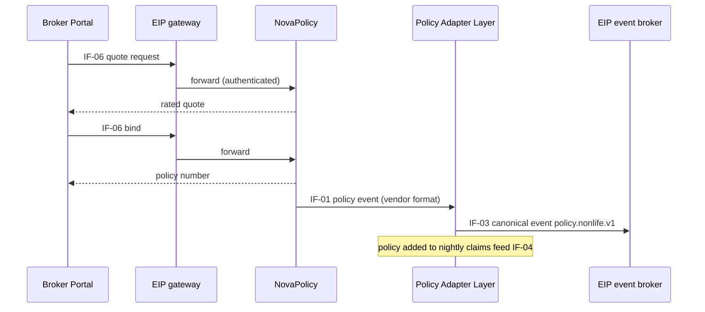
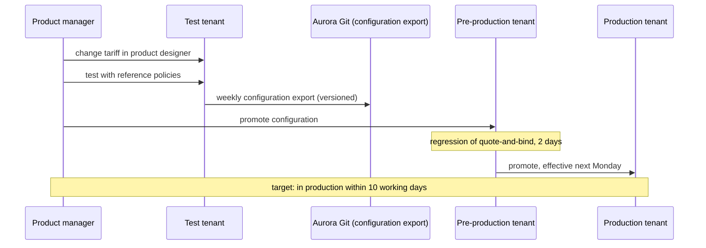
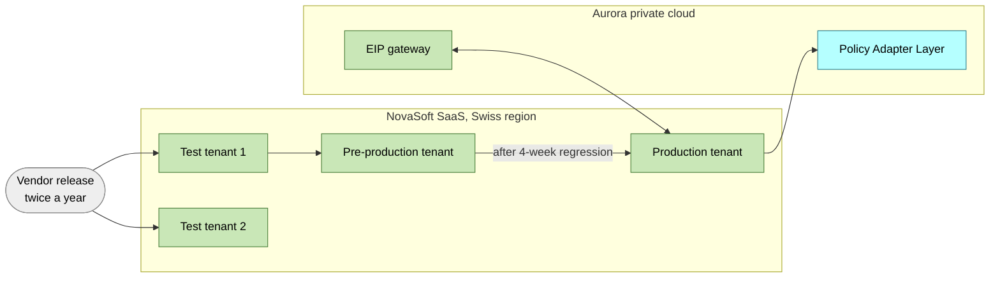

# System Blueprint – NovaPolicy (Buy)

## 1 Introduction and goals
### 1.1 Purpose and scope of use
Policy administration, product definition, rating and quote-and-bind for non-life. In use for
motor from PL-1, for household and liability from PL-2. Billing remains in INKA; NovaPolicy
billing module is licensed but not used.

### 1.2 Quality goals
1. Configurability: new tariff variant without vendor release.
2. Availability 99.5 % in business hours.
3. Upgradeability: two vendor releases per year without custom-code rework.

### 1.3 Stakeholders
Policy operations, product management, NovaSoft (vendor), EIP team, CISO.

## 2 Constraints (inherited)
| ADOIT ID | Principle / standard | Applies because | Fulfilled |
|---|---|---|---|
| EP-04 v2 | product engine of standard package allowed | product definition in NovaPolicy | yes |
| STD-API-01 | OpenAPI via EIP | exposes APIs (IF-06, IF-07) | yes |
| STD-EVT-01 | AsyncAPI, CloudEvents | publishes events (IF-01) | partly: vendor format, mapped by SYS-PAD (ADR-DOM-001) |
| STD-IAM-01 | OIDC via Aurora IAM | has users | yes |
| STD-LOG-01 | SIEM within 15 min | production system | no → ADR-SYS-NOVA-002 (exception) |
| STD-DAT-01 | PII in Switzerland | PII = yes | yes, CH region (ADR-SYS-NOVA-001) |
| STD-OUT-01 | FINMA outsourcing | hosting = vendor SaaS | yes, assessment OA-2026-07 |
| STD-SEC-01 | malware scanning at entry | receives files from outside (broker documents) | yes: files via IF-06 scanned at the EIP gateway; uploads in the vendor user interface scanned by NovaSoft (equivalent control, contract annex, evidence checked in OA-2026-07) |

## 3 Context
<!-- adoit-view: SYS-NOVA-CONTEXT -->

| Interface | ADOIT ID | Partner system | Direction | Technology | Business objects |
|---|---|---|---|---|---|
| Policy events | IF-01 | SYS-PAD | out | webhook (vendor format) | BO-POL, BO-PRM |
| Quote and bind | IF-06 | SYS-BRP | in | REST via EIP gateway | BO-QTE, BO-POL |
| Partner data | IF-07 | SYS-PRT | in | REST via EIP gateway | BO-PRT |
| Audit logs | IF-08 | SYS-SIEM | out | daily file | – |
| Migration load | IF-10 | SYS-MIG | in | vendor migration API | BO-POL, BO-PRM (temporary) |

## 5 Building blocks: modules, configuration, extensions
The vendor's internals are a black box; the view shows what Aurora licenses, configures and extends.

<!-- adoit-view: SYS-NOVA-BUILDING-BLOCKS -->

### 5.1 Licensed modules in use
Product designer, rating engine, policy administration, broker API. Not used: billing.

### 5.2 Configuration
Motor product family (3 products, 14 cover options), underwriting rules, renewal workflow.
Configuration is versioned in the vendor's configuration repository and exported to Git weekly.

### 5.3 Extension points and custom code
| Extension | Mechanism | Owner | Upgrade risk |
|---|---|---|---|
| Swiss vehicle data lookup | vendor plug-in API | PANL team | low |
| Broker commission rules | rules extension | PANL team | medium |

## 6 Runtime
Key scenario quote-and-bind: broker portal calls IF-06 via EIP gateway, NovaPolicy rates,
binds the policy, emits event on IF-01, SYS-PAD publishes canonical event and adds the policy
to the nightly claims feed.

<!-- adoit-view: SYS-NOVA-RUNTIME-QUOTE -->

Scenario "product manager changes a motor tariff":

<!-- adoit-view: SYS-NOVA-RUNTIME-TARIFF -->

## 7 Deployment
<!-- adoit-view: SYS-NOVA-DEPLOYMENT -->

Vendor-managed SaaS, Swiss region, environments: production, pre-production, two test
tenants. Vendor releases twice a year; Aurora regression test window 4 weeks.

## 9 Decisions
| ADR | Title | Type | Status | Date |
|---|---|---|---|---|
| ADR-SYS-NOVA-001 | Vendor SaaS in Swiss region instead of on-premise installation | decision | accepted | 2026-04-15 |
| ADR-SYS-NOVA-002 | Daily audit log delivery to SIEM until vendor release 2028.1 | exception | accepted | 2026-11-04 |

## 10 Quality requirements
| Scenario | Target |
|---|---|
| Tariff change by product manager | in production within 10 working days |
| Vendor upgrade | no custom-code change in 80 % of releases |

## 11 Risks, technical debt, exceptions
| ID | Type | Description | Owner | Expiry / target date | Ticket |
|---|---|---|---|---|---|
| EXC-PANL-001 | exception | daily SIEM logging | T. Brunner | 2028-06-30 | TD-PANL-004 |
| R-NOVA-01 | risk | vendor lock-in for product configuration | A. Meier | – | – |

## 13 Roadmap and transition
| Plateau | Change for this system |
|---|---|
| PL-1 | motor configured and live |
| PL-2 | household and liability configured and live |
| 2028.1 | vendor release with streaming audit logs, exception EXC-PANL-001 closed |
