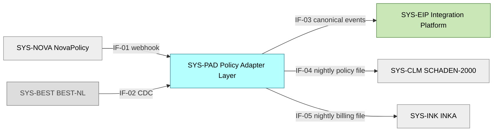
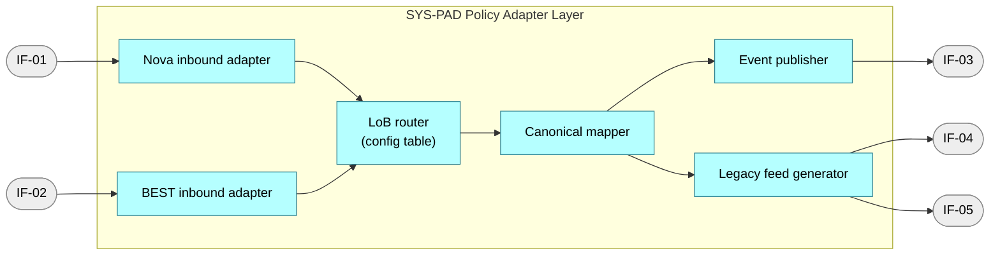
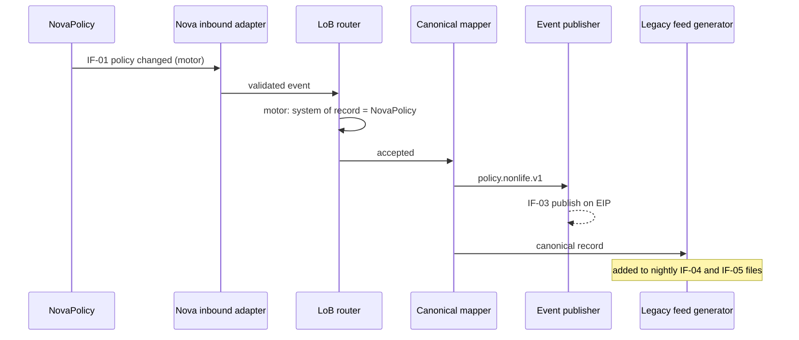
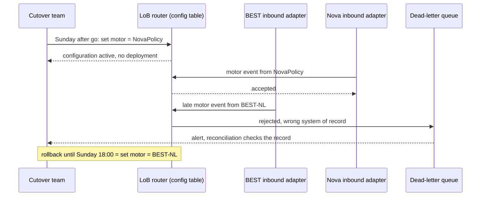
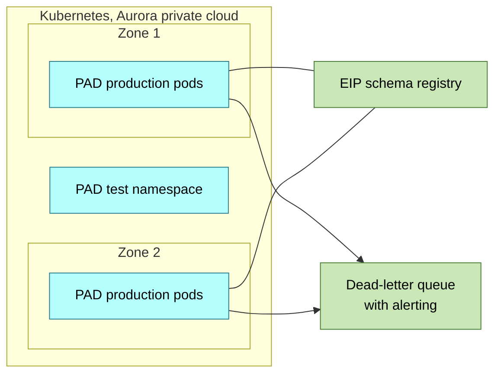

# System Blueprint – Policy Adapter Layer (Make)

## 1 Introduction and goals
### 1.1 Requirements overview
- Translate policy data from NovaPolicy and BEST-NL into the canonical format `policy.nonlife.v1`.
- Route by LoB to the current system of record.
- Generate legacy-format feeds for SCHADEN-2000 (IF-04) and INKA (IF-05) from both sources.

### 1.2 Quality goals
1. Correctness: reconciliation differences 0 after each cutover.
2. Replaceability: a source system can be switched per LoB by configuration.
3. Observability: every message traceable end to end.

### 1.3 Stakeholders
PANL team, claims and collections IT (consumers), EIP team.

## 2 Constraints (inherited)
| ADOIT ID | Principle / standard | Applies because | Fulfilled |
|---|---|---|---|
| EP-02 | integration via EIP | integrates systems | yes, IF-03 on EIP |
| DPP-01 | canonical policy format | publishes policy events | yes |
| DPP-02 | shielded consumers | feeds claims and collections | yes, legacy formats |
| STD-EVT-01 | AsyncAPI, CloudEvents | publishes events | yes |
| STD-LOG-01 | SIEM within 15 min | production system | yes |
| STD-DAT-01 | PII in Switzerland | PII = yes | yes |
| EP-02 (IF-04, IF-05 as files) | no point-to-point | legacy feeds are direct file transfers | partly → TD-PANL-002, covered by ADR-ENT-001 |

## 3 Context
<!-- adoit-view: SYS-PAD-CONTEXT -->

| Interface | ADOIT ID | Partner system | Direction | Technology | Business objects |
|---|---|---|---|---|---|
| Policy events | IF-01 | SYS-NOVA | in | webhook | BO-POL, BO-PRM |
| Change data | IF-02 | SYS-BEST | in | CDC | BO-POL, BO-PRM |
| Canonical events | IF-03 | SYS-EIP | out | event broker | BO-POL, BO-PRM |
| Policy feed | IF-04 | SYS-CLM | out | nightly file | BO-POL |
| Billing instructions | IF-05 | SYS-INK | out | nightly file | BO-PRM |

## 4 Solution strategy
Event-driven adapters per source, a canonical mapping core and per-consumer output adapters.
Java services on Aurora private cloud, schemas in the EIP schema registry.

## 5 Building blocks
<!-- adoit-view: SYS-PAD-COMPONENTS -->

| Component | Responsibility |
|---|---|
| Nova inbound adapter | receives IF-01, validates vendor events |
| BEST inbound adapter | consumes IF-02 CDC stream |
| LoB router | decides system of record per LoB (config table) |
| Canonical mapper | maps to `policy.nonlife.v1` |
| Event publisher | publishes IF-03 |
| Legacy feed generator | builds IF-04 and IF-05 files from canonical data |

## 6 Runtime
Scenario "policy change for a migrated motor policy": NovaPolicy emits event → Nova inbound
adapter → LoB router confirms NovaPolicy is SoR for motor → canonical mapper → event published
→ legacy feed generator adds record to nightly IF-04 and IF-05 files.
(UML sequence diagram allowed here as exception, maintained in ADOIT.)

<!-- adoit-view: SYS-PAD-RUNTIME-CHANGE -->

Scenario "cutover switch of a line of business" (PL-1, motor):

<!-- adoit-view: SYS-PAD-RUNTIME-SWITCH -->

## 7 Deployment
<!-- adoit-view: SYS-PAD-DEPLOYMENT -->

Kubernetes on Aurora private cloud, two zones, production and test.

## 8 Cross-cutting concepts
Idempotent processing, correlation ID per policy version, dead-letter queue with alerting.

## 9 Decisions
| ADR | Title | Type | Status | Date |
|---|---|---|---|---|
| ADR-SYS-PAD-001 | LoB routing by configuration table, not by code | decision | accepted | 2026-06-03 |

## 10 Quality requirements
| Scenario | Target |
|---|---|
| Canonical event latency | below 1 minute |
| Cutover switch of a LoB | configuration change, no deployment |

## 11 Risks, technical debt, exceptions
| ID | Type | Description | Owner | Expiry / target date | Ticket |
|---|---|---|---|---|---|
| TD-PANL-002 | technical debt | legacy file feeds IF-04, IF-05 | T. Brunner | claims / collections modernisation | TD-PANL-002 |
