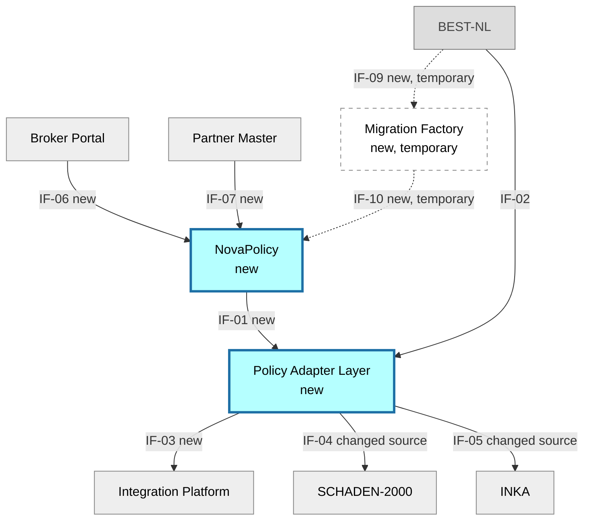
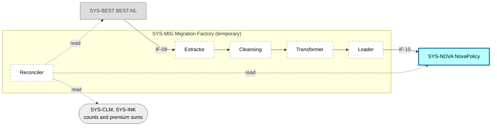
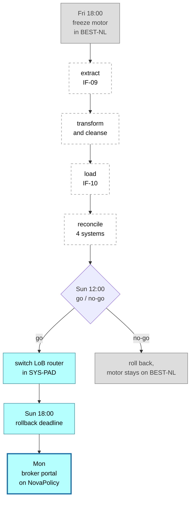

# Solution Blueprint SB-001 – Plateau 1: Motor on NovaPolicy

## 1 Introduction and goals
### 1.1 Goal of the change
Bring motor (about 180,000 in-force policies) live on NovaPolicy by Q4 2027, while
claims and collections continue unchanged.

### 1.2 Triage result
| Question area | Result |
|---|---|
| Change class | initiative |
| Affected DPs / domains | DP-PANL; consumers DP-CLH, DP-COL, DP-BRK, DP-CRM; platforms DP-INT, DP-SEC |
| Affected capabilities | CAP-01, CAP-02, CAP-03 |
| PII concerned | yes (policy, partner, premium) |

## 2 Constraints (delta)
| ADOIT ID | Constraint | Status |
|---|---|---|
| EP-03 | one system of record | not met during migration → ADR-ENT-002 |
| EP-04 v1 | central product platform | not met → waiver ADR-ENT-003, principle changed to v2 |
| STD-OUT-01 | FINMA outsourcing | new for NovaPolicy SaaS, assessment OA-2026-07 |
| STD-DAT-01 | PII in Switzerland | applies to migration factory and NovaPolicy |

## 3 Context (delta)
<!-- adoit-view: SB-001-CONTEXT -->

New: SYS-NOVA, SYS-PAD, SYS-MIG, IF-01, IF-03, IF-06, IF-07, IF-09, IF-10.
Changed: IF-04 and IF-05 now generated by SYS-PAD instead of BEST-NL batch jobs.

## 4 Solution strategy
- Active migration of all in-force motor policies at one cutover weekend (ADR-SOL-001-01).
- Consumers shielded by SYS-PAD (ADR-ENT-001).

## 5 Building blocks (delta)
New System Blueprints: NovaPolicy, Policy Adapter Layer. The Migration Factory exists only here:

| Component of SYS-MIG | Responsibility |
|---|---|
| Extractor | bulk extract from BEST-NL (IF-09) |
| Cleansing | rules for incomplete vehicle data (R-PANL-01) |
| Transformer | BEST-NL model → NovaPolicy migration format |
| Loader | vendor migration API (IF-10) |
| Reconciler | counts and premium sums across BEST-NL, NovaPolicy, SCHADEN-2000, INKA |

<!-- adoit-view: SB-001-BUILDING-BLOCKS -->

## 6 Runtime
Cutover sequence: Friday 18:00 freeze motor in BEST-NL → extract → transform → load →
reconcile → Sunday 12:00 go/no-go → switch LoB router in SYS-PAD → Sunday 18:00 rollback
deadline → Monday broker portal on NovaPolicy.

<!-- adoit-view: SB-001-CUTOVER -->

## 7 Deployment
Migration factory on Aurora private cloud, isolated namespace, deleted 3 months after PL-1.

## 8 Cross-cutting concepts
Data migration with three dress rehearsals, reconciliation reports signed off by business.

## 9 Decisions
| ADR | Title | Type | Target blueprint after return | Status |
|---|---|---|---|---|
| ADR-SOL-001-01 | Active migration at cutover instead of migration at renewal | decision | DP Blueprint DP-PANL (later domain pattern) | accepted |
| ADR-ENT-001 | claims and collections fed by policy domain | decision | Enterprise Blueprint | accepted (decided during SB-001) |
| ADR-ENT-002 | dual system of record | exception | Enterprise Blueprint | accepted |
| ADR-ENT-003 | integrated product engine | waiver | Enterprise Blueprint | accepted |

## 11 Risks, technical debt, exceptions
| ID | Type | Description | Owner | Expiry / target date | Ticket |
|---|---|---|---|---|---|
| R-SB1-01 | risk | 4 % motor policies with incomplete vehicle data | A. Meier | cleansed before dress rehearsal 2 | PANL-112 |
| R-SB1-02 | risk | claims feed IF-04 mismatch after cutover | L. Weber | reconciliation in dress rehearsals | PANL-118 |

## 13 Roadmap and transition
Delivers PL-1 (Q4 2027). Planned reuse: SB-002 for household and liability (PL-2).

## Return checklist (required before archiving)
Status at 2026-11-12: implementation running, return not yet due.
- [ ] ADRs moved to the lowest living blueprint covering all parties (ADR-SOL-001-01 → DP-PANL)
- [ ] System Blueprints updated: NovaPolicy, Policy Adapter Layer
- [ ] DP / Domain Blueprints updated: DP-PANL chapter 5 and 13, DOM-PP chapter 8
- [ ] ADOIT model updated: PL-1 reached, SYS-MIG retired, IF-09 and IF-10 removed
- [ ] Exceptions and technical debt registered (EXC-ENT-002, TD-PANL-002)
- [ ] Reuse checked: SB-002 reuses SB-001 → propose domain pattern "LoB migration"
