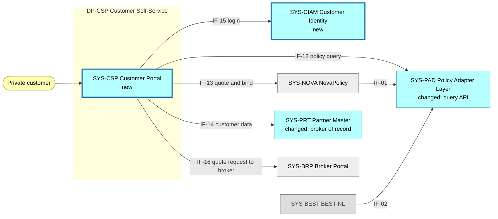
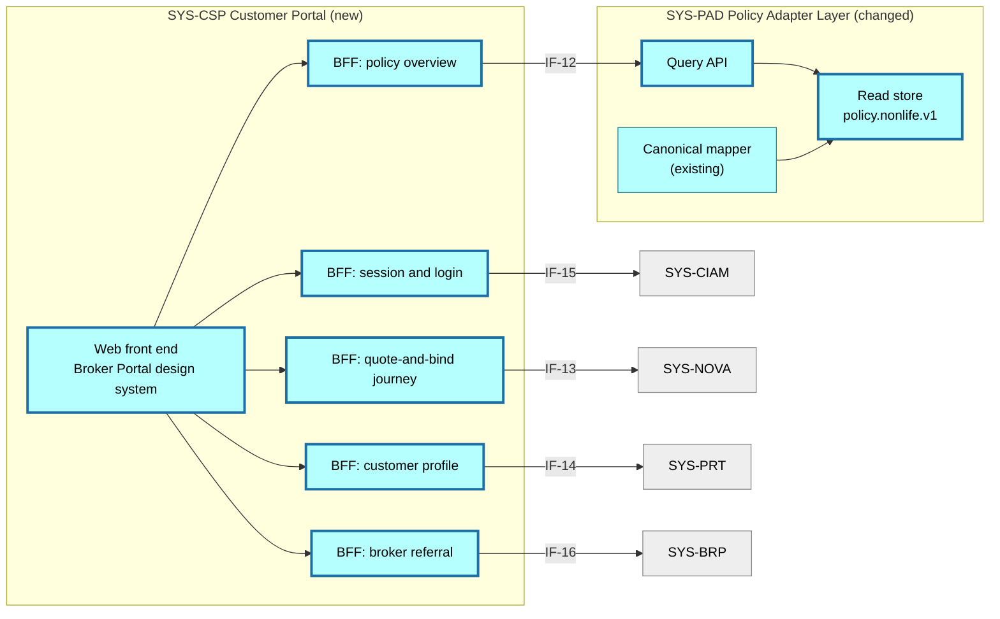
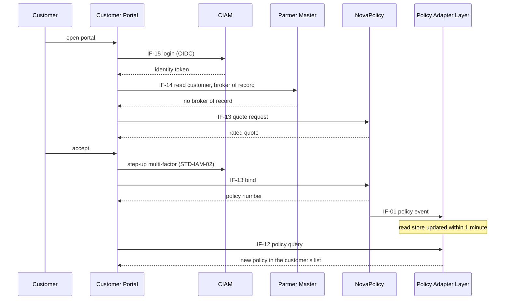
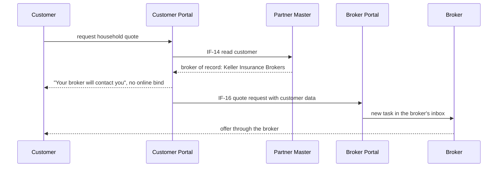
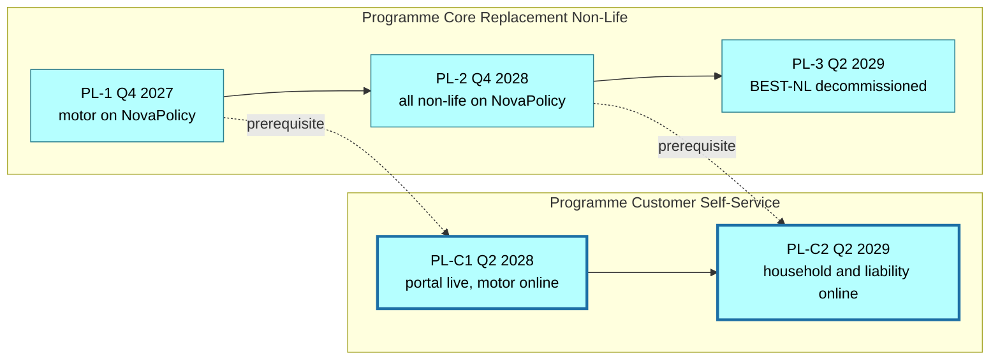

# Solution Blueprint SB-005 – Customer Self-Service, plateau C1

## 1 Introduction and goals
### 1.1 Goal of the change
Give private customers a portal in which they see all their non-life policies and, if they have
no broker, buy motor insurance online. Contributes to the new strategic goal SG-5.

### 1.2 Triage result
| Question area | Result |
|---|---|
| Change class | initiative (two plateaus, depends on the core replacement) |
| Strategic goal served | none of SG-1 to SG-4 → escalated to enterprise level, SG-5 added (ADR-ENT-004) |
| Affected DPs / domains | new DP-CSP (DOM-CD); DP-PANL (DOM-PP); DP-SEC, DP-INT (DOM-TP); DP-CRM, DP-BRK (DOM-CD) |
| Affected capabilities | CAP-06, CAP-07, CAP-02, CAP-03 |
| PII concerned | yes, exposed to the internet for the first time |

## 2 Constraints (delta)
| ADOIT ID | Constraint | Status |
|---|---|---|
| ADR-ENT-002, DPP-02 | consumers never read policy systems directly | met: portal reads via SYS-PAD (ADR-DOM-002) |
| EP-01 | buy before make | portal built in-house → ADR-SOL-005-01 |
| STD-IAM-02 | customer authentication via CIAM | new standard (ADR-ENT-005) |
| STD-OUT-01 | FINMA outsourcing | applies to SYS-CIAM (vendor SaaS), assessment due before PL-C1 |
| STD-DAT-01 | PII in Switzerland | applies to SYS-CSP and SYS-CIAM |
| STD-API-01 | APIs via EIP gateway | IF-12 to IF-14 |

## 3 Context (delta)
New: SYS-CSP, SYS-CIAM, IF-12 to IF-16. Changed: SYS-PAD (query API), BO-PRT (broker of record).
Reused unchanged: the quote-and-bind API of NovaPolicy (IF-13 uses the same API as IF-06).

<!-- adoit-view: SB-005-CONTEXT -->

## 4 Solution strategy
- Own development, reusing the Broker Portal stack (ADR-SOL-005-01).
- All data through APIs on the EIP gateway; the portal stores no policy data itself.
- Policies are read from a canonical read store in SYS-PAD (ADR-DOM-002), so the portal does not
  notice which system holds a line of business.
- Bind is offered only if the customer has no broker of record (ADR-ENT-004); otherwise the quote
  request goes to the broker.
- Customer login through the central CIAM platform (ADR-ENT-005).

## 5 Building blocks (delta)
| Building block | Change | Owner after return |
|---|---|---|
| SYS-CSP Customer Portal | new system: web front end, backend for the front end | DP-CSP (new DP Blueprint, new System Blueprint) |
| SYS-CIAM Customer Identity | new platform system | DP-SEC |
| SYS-PAD read store | new component, fed by IF-01 and IF-02 | DP-PANL (System Blueprint SYS-PAD) |
| SYS-PAD query API | new component, publishes IF-12 | DP-PANL |
| SYS-PRT | new attribute broker of record on BO-PRT | DP-CRM |

<!-- adoit-view: SB-005-BUILDING-BLOCKS -->

## 6 Runtime
Scenario "customer without broker buys motor insurance":

<!-- adoit-view: SB-005-RUNTIME-BIND -->

If the customer has a broker of record, the portal shows the quote request form and sends it via
IF-16 to the Broker Portal instead of binding.

Scenario "customer with a broker of record asks for a household quote":

<!-- adoit-view: SB-005-RUNTIME-REFERRAL -->

## 7 Deployment
Customer Portal on the Aurora private cloud behind the internet-facing EIP gateway, with web
application firewall. CIAM as vendor SaaS in a Swiss region.

## 9 Decisions
| ADR | Title | Type | Owned by | Status |
|---|---|---|---|---|
| ADR-ENT-004 | direct digital channel with broker-of-record protection | decision | Enterprise Blueprint, from the start | accepted |
| ADR-ENT-005 | customer identity as a central platform service | decision | Enterprise Blueprint, from the start | accepted |
| ADR-DOM-002 | policy query API on SYS-PAD with read store | decision | Domain Blueprint DOM-PP, from the start | accepted |
| ADR-SOL-005-01 | customer portal as own development | decision | moves to DP Blueprint DP-CSP on return | accepted |

## 10 Quality requirements
| Scenario | Target |
|---|---|
| Policy list after login | below 2 s for 95 % of requests |
| Availability of portal and IF-12 | 99.5 % (SYS-PAD availability target rises accordingly) |
| New policy visible in the portal | within 1 minute after bind |

## 11 Risks, technical debt, exceptions
| ID | Type | Description | Owner | Expiry / target date | Ticket |
|---|---|---|---|---|---|
| R-ENT-02 | risk | brokers perceive the portal as competition | Head of Distribution | broker information before PL-C1 | – |
| R-SB5-01 | risk | PII exposed to the internet for the first time | CISO | penetration test before PL-C1 | CSP-031 |
| R-SB5-02 | risk | broker-of-record data incomplete for older policies | F. Bucher | data cleansing in DP-CRM before PL-C1 | CRM-077 |

## 13 Roadmap and transition
Delivers PL-C1 (Q2 2028). SB-006 delivers PL-C2 after PL-2 of the core replacement.

<!-- adoit-view: SB-005-PLATEAUS -->

## Return checklist (required before archiving)
Status at 2026-11-16: approved, implementation starting. Decisions at enterprise and domain level
are already in their living blueprints; everything else returns after PL-C1.
- [x] ADR-ENT-004, ADR-ENT-005 in the Enterprise Blueprint; ADR-DOM-002 in the Domain Blueprint DOM-PP
- [ ] ADR-SOL-005-01 moved to the new DP Blueprint DP-CSP
- [ ] New DP Blueprint DP-CSP and System Blueprint Customer Portal written
- [ ] System Blueprint SYS-PAD updated: read store, query API, IF-12, availability target
- [ ] DP Blueprint DP-PANL chapter 3 updated: IF-12 and IF-13 as cross-DP interfaces
- [ ] Domain Blueprint DOM-CD chapter 5 updated: DP-CSP; DP-SEC updated: SYS-CIAM
- [ ] ADOIT model updated: lifecycle of SYS-CSP, SYS-CIAM, IF-12 to IF-16 from "planned" to "target"
- [ ] Reuse checked: CIAM connection documented as platform offering for the next customer application
