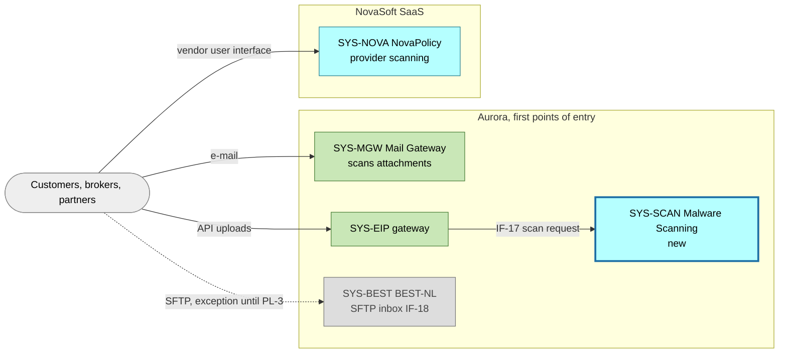
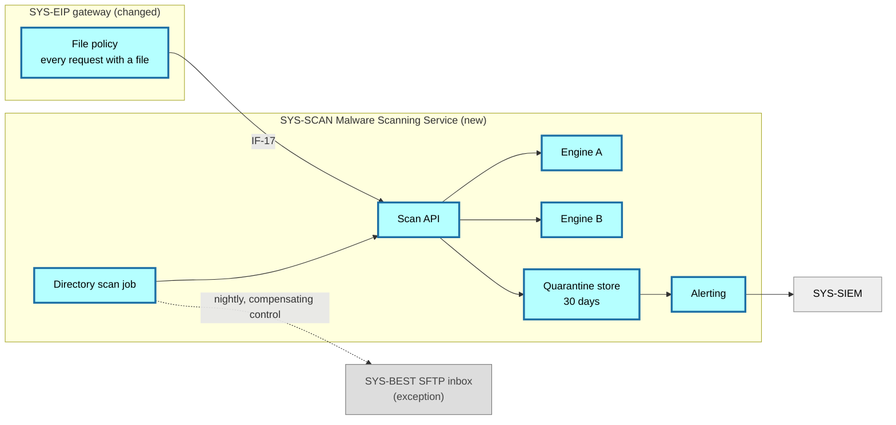
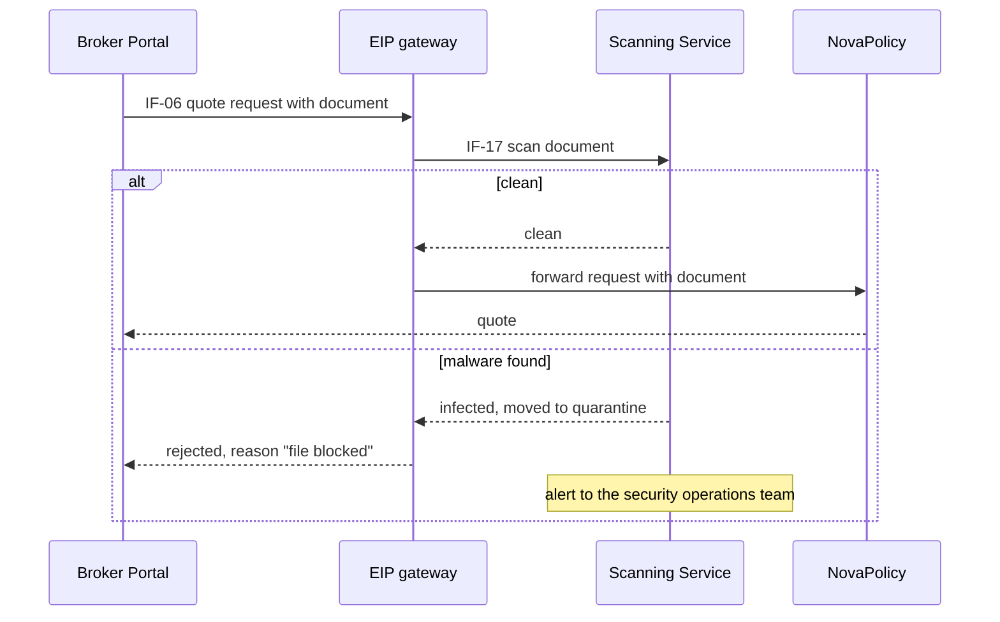
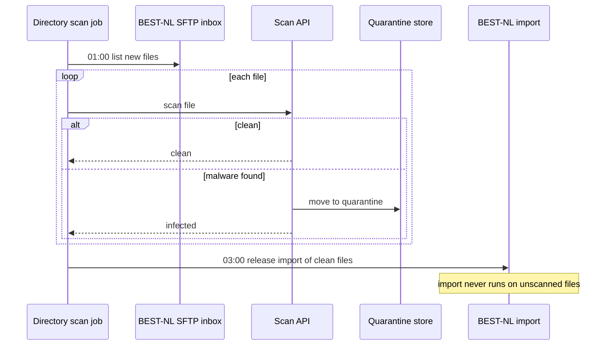

# Solution Blueprint SB-007 – Malware Scanning at Entry, plateau S1

## 1 Introduction and goals
### 1.1 Goal of the change
Every file that enters Aurora from outside is scanned for malware once, at its first point of
entry, as required by the new standard STD-SEC-01. Contributes to SG-4 (operational resilience).

### 1.2 Triage result
| Question area | Result |
|---|---|
| Change class | change (new platform service, used across domains) |
| Trigger | new standard STD-SEC-01 (ADR-ENT-006), not a business demand |
| Strategic goal served | SG-4 |
| Affected DPs / domains | DP-SEC, DP-INT (DOM-TP); every DP whose systems receive files from outside, derived from the model |
| PII concerned | yes, in transit (documents of customers and brokers) |

## 2 Constraints (delta)
| ADOIT ID | Constraint | Status |
|---|---|---|
| STD-SEC-01 | scan at first point of entry, provider scanning accepted with evidence | new |
| STD-OUT-01 | FINMA outsourcing | now also covers the provider's malware scanning for every SaaS system |
| STD-DAT-01 | PII in Switzerland | SYS-SCAN on Aurora private cloud; no file leaves Switzerland for scanning |

### 2.1 Compliance overview (generated from the model)
STD-SEC-01 applies to every system with the attribute "receives files from outside". This overview
is the rollout plan: each row becomes a row in chapter 2 of the system's blueprint.

| System | Entry point | How STD-SEC-01 is met | Verdict |
|---|---|---|---|
| SYS-MGW Mail Gateway | e-mail attachments | already scans attachments | yes |
| SYS-EIP Integration Platform | files in API calls, e.g. IF-06, IF-13 | calls SYS-SCAN for every file (IF-17) | yes from PL-S1 |
| SYS-NOVA NovaPolicy | uploads in the vendor user interface | provider scanning, evidenced (contract annex, OA-2026-07 updated) | yes, by provider |
| SYS-CIAM Customer Identity | none (no file upload) | – | not applicable |
| SYS-CSP Customer Portal | none in PL-C1; future uploads through the EIP gateway | pattern "Scan at entry" | yes by design |
| SYS-BEST BEST-NL | broker document inbox IF-18 (SFTP), not in the model before this rollout | not scanned | no → exception ADR-SYS-BEST-001 |

## 3 Context (delta)
<!-- adoit-view: SB-007-CONTEXT -->

## 4 Solution strategy
- One central scanning service instead of one per system (ADR-ENT-006).
- Scanning happens in the gateways that already exist: mail gateway and EIP gateway.
- SaaS systems are covered by evidence, not by routing: the provider's scanning is part of the
  contract and of the outsourcing assessment.
- Gaps found during the rollout become exceptions, decided according to the delegation matrix.

## 5 Building blocks (delta)
| Building block | Change | Owner after return |
|---|---|---|
| SYS-SCAN Malware Scanning Service | new platform system (standard product, two engines) | DP-SEC |
| SYS-EIP gateway | new policy: every request with a file calls IF-17 before forwarding | DP-INT |
| Quarantine store | new component of SYS-SCAN, retention 30 days | DP-SEC |

<!-- adoit-view: SB-007-BUILDING-BLOCKS -->

## 6 Runtime
Scenario "broker uploads a document with a quote request":

<!-- adoit-view: SB-007-RUNTIME-UPLOAD -->

Scenario "compensating control for the BEST-NL inbox" (until PL-3):

<!-- adoit-view: SB-007-RUNTIME-NIGHTLY -->

## 9 Decisions
| ADR | Title | Type | Owned by | Status |
|---|---|---|---|---|
| ADR-ENT-006 | malware scanning at first point of entry, provider scanning equivalent | decision | Enterprise Blueprint, from the start | accepted |
| ADR-SYS-BEST-001 | BEST-NL broker inbox without scanning until PL-3 | exception | DP Blueprint DP-PANL (BEST-NL has no System Blueprint) | accepted |

## 10 Quality requirements
| Scenario | Target |
|---|---|
| Added latency per file through the EIP gateway | below 2 s for files up to 10 MB |
| Scanning service unavailable | gateway rejects files (fail closed); availability 99.9 % |

## 11 Risks, technical debt, exceptions
| ID | Type | Description | Owner | Expiry / target date | Ticket |
|---|---|---|---|---|---|
| EXC-PANL-002 | exception | BEST-NL broker inbox without scanning at entry (ADR-SYS-BEST-001) | T. Brunner | 2029-06-30 | TD-PANL-005 |
| R-SB7-01 | risk | false positives block broker business | K. Steiner | tuning in pilot with five brokers | SEC-061 |
| R-SB7-02 | risk | further unmodelled entry points exist | J. Moser | network scan for inbound file services before PL-S1 | SEC-062 |

## 13 Roadmap and transition
Delivers PL-S1 (Q3 2027), before motor goes live on NovaPolicy (PL-1), so the new broker and
customer channels start with scanning in place.

## Return checklist (required before archiving)
Status at 2026-11-16: approved, implementation starting. ADR-ENT-006 is already in the Enterprise
Blueprint, the exception in the DP Blueprint DP-PANL.
- [x] ADR-ENT-006 in the Enterprise Blueprint; ADR-SYS-BEST-001 and EXC-PANL-002 in the DP Blueprint DP-PANL
- [x] STD-SEC-01 row added to chapter 2 of the System Blueprint NovaPolicy
- [ ] System Blueprint SYS-SCAN written (DP-SEC); EIP gateway policy documented (DP-INT)
- [ ] Chapter 2 of every other affected System Blueprint updated from the compliance overview
- [ ] ADOIT model updated: SYS-SCAN and IF-17 from "planned" to "target"; attribute "receives files from outside" verified for all systems
- [ ] Pattern "Scan at entry" confirmed in the Enterprise Blueprint after the first reuse
